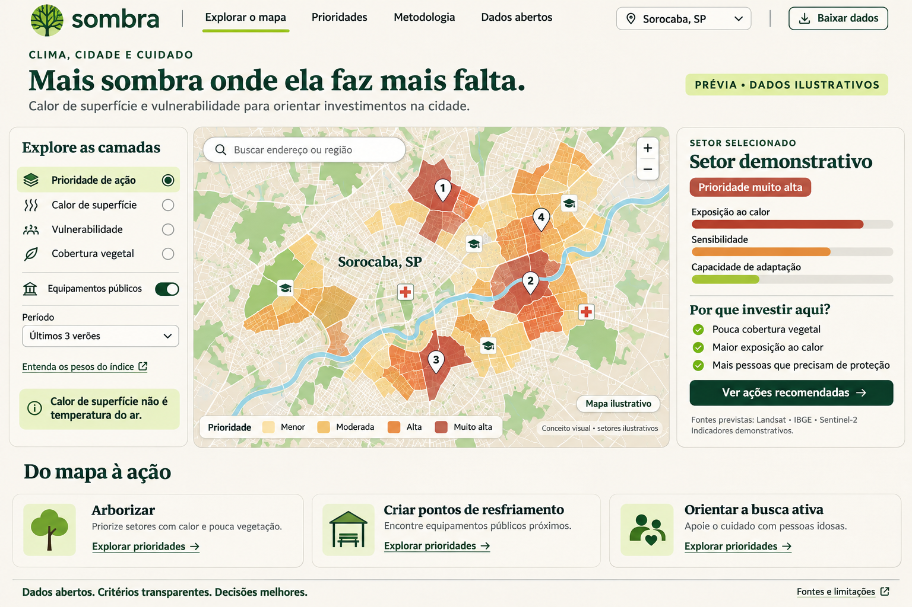

<p align="center">
  
</p>

# Sombra

Mapa de calor urbano × vulnerabilidade para priorizar arborização e proteção. Uma iniciativa [CivisBR](https://github.com/civisbr).

> Em quais quarteirões da cidade o calor extremo atinge quem tem menos defesa, e onde plantar árvores e abrir pontos de resfriamento primeiro?

Ondas de calor matam no Brasil, e matam de forma desigual. O Sombra é uma ferramenta aberta e padronizada, aplicável a qualquer município brasileiro, que:

1. mapeia a temperatura de superfície no verão por setor censitário (Landsat 8/9);
2. combina com vulnerabilidade social e demográfica do Censo 2022;
3. gera um índice de prioridade e três listas acionáveis: onde **arborizar**, onde abrir **pontos de resfriamento** e onde a atenção primária deve fazer **busca ativa** de idosos.

Cidade-piloto: Sorocaba-SP (`cities/3552205.toml`). O pipeline recebe o código IBGE de 7 dígitos como parâmetro.

**O que não é:** não mede a temperatura do ar dentro das casas e não é sistema de alerta meteorológico (isso é do INMET/Defesa Civil). Calor de superfície não é temperatura do ar.



## Estado atual

| Fase | Entrega | Estado |
|---|---|---|
| 0 | Fundação: `uv`, `ruff`, `pytest`, Makefile, config por cidade, esqueleto ponta a ponta | feito |
| 1 | Calor de superfície: conversão, máscara, anomalia, composição e agregação por setor | núcleo testado; coleta Landsat escrita (`ingest/landsat.py`), **ainda não executada contra o STAC** |
| 2 | Vulnerabilidade: Censo 2022, NDVI, distância à UBS | padronização pronta; ingestão (`ibge`, `sentinel2`, `osm`) pendente |
| 3 | Índice, sensibilidade e listas de ação | índice, pesos alternativos e listas prontos sobre dados sintéticos; **pendentes:** PCA na sensibilidade e filtro de calçada/praça (OSM) na lista de arborização |
| 4 | Site: mapa, prioridades, metodologia, dados abertos | pronto, com dados sintéticos; cidade escolhida por `?cidade=<ibge>` (não `/<ibge>`); sem PMTiles ainda (GeoJSON direto) |
| 5–6 | Escala, validação entre municípios, ECOSTRESS | pendente |

**Importante:** hoje o site e `make city` usam uma **cidade sintética** (`sombra/demo.py`), marcada como "Prévia • dados ilustrativos". Nenhum número exibido descreve um bairro real. No demo, a sobreposição do top 10% sob pesos alternativos fica abaixo da meta de 70%; o critério de aceite só vale para os dados reais do piloto.

## Uso

```bash
make install            # uv sync --extra ingest
make test               # pytest
make lint               # ruff
make city CITY=3552205  # pipeline ponta a ponta com dados sintéticos -> web/data/
python3 -m http.server -d web 8000   # abre o site em http://localhost:8000
```

Contagens abaixo de 5 (moradores, idosos) são suprimidas na exportação.

Rodar sem `--demo` falha com mensagem clara enquanto a ingestão do IBGE não existir.

## Publicação

| Site | Onde | Workflow | Conteúdo |
|---|---|---|---|
| Projeto Sombra | GitHub Pages: https://civisbr.github.io/sombra/ | `pages.yml` (pasta `site/`) | o que é, como funciona, cidades, limitações |
| Sombra em Sorocaba | Cloudflare Pages: https://sombra-dwm.pages.dev/ | `deploy.yml` (pasta `web/`) | mapa, prioridades, metodologia e dados de Sorocaba |

O GitHub Pages precisa estar em *Settings → Pages → Source: GitHub Actions* (`gh api -X PUT repos/civisbr/sombra/pages -f build_type=workflow`). O deploy no Cloudflare roda testes, gera os dados de Sorocaba e publica `web/`. Configuração única:

1. O workflow cria o projeto `sombra` se ele não existir. A Cloudflare escolhe o subdomínio (hoje `sombra-dwm.pages.dev`, porque `sombra` estava ocupado); se mudar, atualizar os links em `site/index.html` e neste README.
2. Criar um token de API dedicado, com a permissão *Cloudflare Pages: Edit* só para a conta e com data de expiração.
3. Em Settings → Environments, criar `cloudflare-pages` restrito à branch `main` e cadastrar nele, como *environment secrets*, `CLOUDFLARE_API_TOKEN` e `CLOUDFLARE_ACCOUNT_ID`.

Enquanto o pipeline real não existir, o mapa de Sorocaba é a prévia com dados ilustrativos.

## Metodologia (resumo)

- **Calor:** `ST_B10` do Landsat C2 L2 (`K = DN × 0.00341802 + 149.0`), máscara por `QA_PIXEL`, anomalia de cada pixel contra a mediana urbana da cena, mediana das anomalias, média e P90 por setor.
- **Índice:** média geométrica de exposição, sensibilidade e baixa capacidade de adaptação, cada uma em percentil dentro da cidade, com pesos iguais e documentados.
- **Robustez:** pesos alternativos (um componente dobrado, um indicador removido) e sobreposição do top 10%.
- **Validação planejada:** LST × temperatura do ar (INMET), comparação com estudos locais e, entre municípios, excesso de mortalidade em ondas de calor (SIM).

Detalhes, limitações e referências científicas em [`PROJECT.md`](PROJECT.md) e na página de metodologia do site.

## Estrutura

```
sombra/
  cities/        # <codigo_ibge>.toml: bbox, anos, estações INMET
  sombra/
    ingest/ heat/ vulnerability/ index/ actions/ validate/ publish/
    demo.py pipeline.py cli.py
  web/           # site estático (MapLibre GL, sem rastreio)
  tests/
```

Código e identificadores em inglês; documentação e site em português.

## Ética e dados

Só agregados por setor censitário; nenhum dado individual. O foco é onde investir, não "onde é ruim". Código sob [MIT](LICENSE). Dados derivados sob CC BY 4.0, citando NASA/USGS, ESA/Copernicus, IBGE, INMET e DATASUS.
